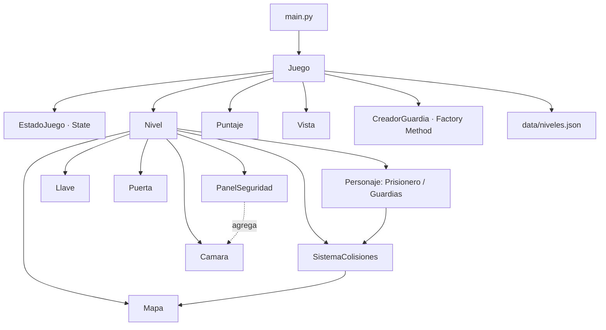

# Fuga de la Prisión

Videojuego 2D de sigilo, estrategia y escape desarrollado en **Python** con **Pygame**.

**Universidad Peruana Cayetano Heredia (UPCH)**  
Facultad de Ciencias e Ingeniería · Carrera de Ingeniería Informática  
Curso: Programación Orientada a Objetos | Semestre 2026-II

---

## Descripción

Un prisionero aprovecha un descuido en el turno nocturno para escapar atravesando **7 sectores** de la prisión: evade guardias con linternas direccionales, cámaras de vigilancia y paneles de energía, hasta enfrentarse al **Alcaide** en un **Boss Run** final entre obstáculos.

## Niveles

| Nivel | Escenario | Música | Mecánica principal |
|---|---|---|---|
| 1 – 2 | Pabellón de celdas (Secciones 1 y 2) | `nivel_1_prision.wav` | Patrullas, centinelas, cámaras y panel de seguridad |
| 3 – 4 | Lavandería (Secciones 1 y 2) | `nivel_2_infiltracion.wav` | Pasillos con obstáculos, linternas cruzadas y cámaras |
| 5 – 6 | Patio de vigilancia (Secciones 1 y 2) | `nivel_3_escape.wav` | Vigilancia múltiple y rutas tácticas de flanqueo |
| 7 | Arena del Alcaide · ¡Boss Run! | `nivel_3_escape.wav` | Persecución BFS en 2 fases (furia + embestidas), cámaras pulsantes, panel aturdidor y escolta final |

## Arquitectura y Diagramas UML

El diseño completo de las **23 clases** se encuentra en [diagramas_uml/UML_Fuga_Prision_v1.pdf](diagramas_uml/UML_Fuga_Prision_v1.pdf) (con archivos editables en `diagramas_uml/drawio/`).



## Pilares de POO y Patrones de Diseño

- **Encapsulamiento y Abstracción:** atributos privados (`__rect`, `__valor`, `__mapa`), getters con copia segura y clases abstractas (`ABC`) en `Personaje`, `Guardia`, `CreadorGuardia` y `EstadoJuego`.
- **Herencia (≤ 3 niveles):** `Personaje` → `Prisionero` / `Guardia` → `GuardiaPatrulla`, `GuardiaCentinela`; `CreadorGuardia` → `CreadorPatrulla`, `CreadorCentinela`; `EstadoJuego` → `Jugando`, `Pausa`, `Derrota`, `Victoria`.
- **Polimorfismo:** `Juego.actualizar_nivel(dt)` actualiza todos los personajes con una sola llamada `personaje.update(dt)`.
- **Composición y Agregación:** `Nivel` posee su mapa, colisiones y entidades; `PanelSeguridad` agrega referencias a `Camara` para apagarlas temporalmente (`8 s`).
- **Patrón Factory Method (`src/patrones/creadores.py`):** `CreadorGuardia.incorporar()` delega la instanciación al método abstracto `crear()`.
- **Patrón State (`src/patrones/estados.py`):** `Juego` delega entrada y actualización al estado activo (`Jugando`, `Pausa`, `Derrota`, `Victoria`).
- **SOLID (SRP y OCP) + JSON:** niveles y decoraciones cargados desde `data/niveles.json` con manejo de `FileNotFoundError` y `json.JSONDecodeError`.

## Estructura del proyecto

```text
FugaPrision/
├── audio/                # 3 pistas .wav
├── data/niveles.json     # Configuración de los 7 niveles
├── diagramas_uml/        # PDF UML v1 (23 clases) y archivos .drawio
├── img/                  # Sprites y tilesets (108 PNGs activos)
├── src/
│   ├── entidades/        # personajes.py
│   ├── escenario/        # mapa.py, sistema_colisiones.py, seguridad.py, nivel.py
│   ├── patrones/         # creadores.py (Factory Method), estados.py (State)
│   └── juego/            # juego.py, puntaje.py, vista.py
├── main.py
├── requirements.txt
└── README.md
```

## Instalación y ejecución

**Linux:**
```bash
python -m venv .venv
.venv/bin/python -m pip install -r requirements.txt
.venv/bin/python main.py
```

**Windows (PowerShell):**
```powershell
python -m venv .venv
.venv\Scripts\python.exe -m pip install -r requirements.txt
.venv\Scripts\python.exe main.py
```

## Controles

| Acción | Tecla |
|---|---|
| Menú principal | `↑ / ↓` (`W / S`) o ratón + `Enter` / clic |
| Mover al prisionero | `WASD` o flechas |
| Pausar / continuar | `P` o `Esc` |
| Volver al menú (en Pausa / Derrota / Victoria) | `M` |
| Reintentar nivel / Nueva partida | `R` |
| Pantalla completa | `F11` |
