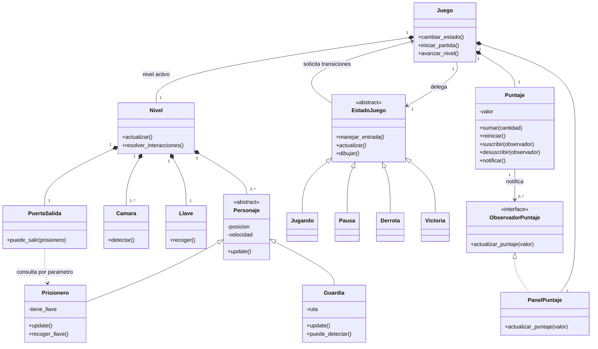
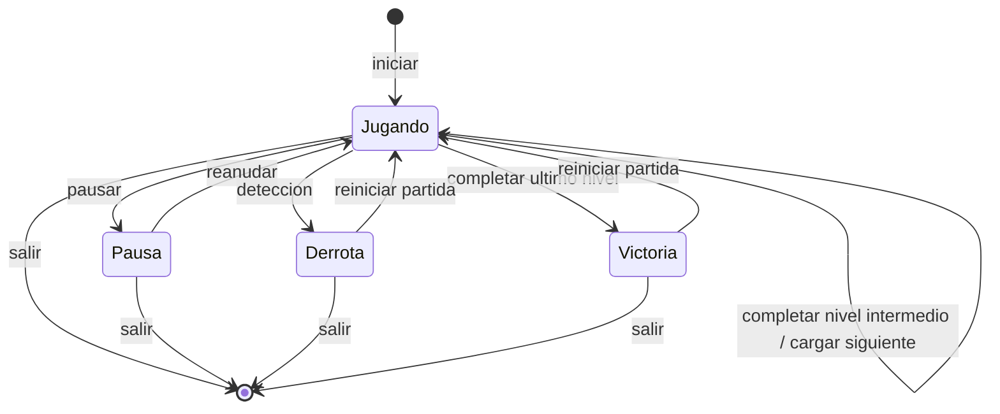

# Fuga de la Prisión: planificación y documentación base

> Antecedente de planificación. El avance vigente está en `02_informe_parcial.md` y en el informe de la carpeta `entrega`. Varias propuestas de esta versión ya se implementaron; se conserva el contenido original para distinguir planificación de ejecución.

**Versión:** 0.1, 8 de octubre de 2026.  
**Curso:** Programación Orientada a Objetos, ciclo 2026-2.  
**Lenguaje confirmado:** Python.  
**Entrega parcial informada por el estudiante:** 16 de octubre de 2026.  
**Estado:** diseño inicial, pendiente de revisión con el equipo. No representa funcionalidades implementadas ni resultados de pruebas.

## 1. Por dónde empezar y por qué

Primero definimos el alcance: qué puede hacer el jugador, qué obstáculos enfrenta, cómo gana o pierde y qué debe demostrar el proyecto. Después identificamos los objetos y sus responsabilidades, dibujamos UML y construimos una versión pequeña que se pueda jugar.

El orden de trabajo será: requisitos → reglas del juego → clases y relaciones → prototipo → pruebas y documentación de lo realmente construido. El diseño se revisará a medida que el prototipo revele problemas.

Esta primera versión ya desarrolla la base del informe. Los nombres, valores de equilibrio y fechas internas son propuestas editables. Los requisitos del docente se identifican con su página de origen.

## 2. Revisión completa del archivo del curso

Fuente: [Proyecto Final POO.pdf](<C:/Users/Jhosef/Downloads/Proyecto Final POO.pdf>). Se extrajo el texto y se inspeccionaron visualmente sus tres páginas.

| Página | Contenido revisado | Implicación para este proyecto |
|---|---|---|
| 1 | Identificación del curso, resumen ejecutivo, objetivo, reglas de selección y temas 1 a 5 | Se exige un videojuego 2D con niveles, protagonista, personajes secundarios y puntuación. El propósito es aplicar POO y patrones de diseño. |
| 2 | Temas 6 a 15, requisitos de arquitectura y mínimo de patrones | El tema 13 es Fuga de la Prisión. Se exige UML, herencia, polimorfismo mediante `update()`, encapsulamiento, abstracción, composición, dependencia y Git durante el desarrollo. |
| 3 | Tabla de patrones e integración externa | Deben elegirse al menos dos entre State, Observer y Factory Method. La API tiene una redacción ambigua. |

El PDF presenta quince temáticas; el grupo debe desarrollar una sola y no puede repetir la de otro grupo. El estudiante confirmó que les corresponde Fuga de la Prisión. Su idea inicial es escapar esquivando guardias, cámaras y sistemas de seguridad.

El documento permite añadir mecánicas coherentes con la temática. No establece que el personaje sea un ladrón ni exige habilidades especiales para este tema. Se propone llamarlo **Prisionero** hasta que el equipo defina su historia. La mención a habilidades especiales aparece en otra temática, Defensa del Castillo.

### 2.1 Requisitos del proyecto final

| ID | Exigencia del PDF | Fuente | Evidencia que deberá existir |
|---|---|---|---|
| R01 | Videojuego 2D | p. 1 | Ventana gráfica y partida jugable. |
| R02 | Distintos niveles | p. 1 | Transición entre al menos dos niveles distintos; el PDF no fija una cantidad exacta. |
| R03 | Al menos un personaje principal y personajes secundarios | p. 1 | Prisionero controlable y guardias con comportamiento propio. |
| R04 | Conteo de puntuación | p. 1 | Puntaje visible y actualizado por eventos del juego. |
| R05 | Coherencia con la temática seleccionada | pp. 1-2 | Escape de una prisión con guardias, cámaras y seguridad. |
| R06 | Diseño y diagramación UML | p. 2 | Diagrama de clases consistente con el código; otros diagramas sirven de apoyo. |
| R07 | Herencia y polimorfismo de personajes mediante una llamada `update()` | p. 2 | Una colección de personajes actualizada con la misma llamada y comportamientos diferentes. |
| R08 | Encapsulamiento y abstracción; protección de atributos críticos | p. 2 | Contratos de clases y métodos que validen cambios de puntaje, posición y estado. |
| R09 | Composición y dependencia | p. 2 | Relaciones identificables en UML y en la implementación. |
| R10 | Git durante todo el desarrollo | p. 2 | Historial real de avances, desde documentación y prototipo. |
| R11 | Al menos dos patrones entre State, Observer y Factory Method | pp. 2-3 | Clases participantes, interacción y explicación del problema que resuelven. |

### 2.2 Lo que falta precisar

- **Entrega parcial:** el PDF describe el proyecto final, pero no contiene fecha, rúbrica, porcentaje de avance, índice obligatorio ni lista de entregables del parcial. El 16 de octubre proviene del estudiante.
- **API externa:** el resumen y el encabezado la presentan como sugerencia; el cuerpo de la p. 3 dice que el videojuego debe integrarla. Consultar si será obligatoria y en qué entrega. Se reserva como trabajo condicionado, sin afirmar que pueda omitirse definitivamente.
- **Tecnología gráfica:** Python está confirmado por el estudiante; biblioteca y versiones todavía no se han seleccionado.
- **Organización:** faltan integrantes, responsabilidades nominales, formato del informe y duración de la exposición.

No hay una rúbrica de puntuación del proyecto en estas tres páginas. No debe confundirse la puntuación dentro del videojuego con la nota académica.

## 3. Presentación inicial del proyecto

### 3.1 Título provisional

**Fuga de la Prisión: videojuego 2D de escape y sigilo desarrollado en Python.**

### 3.2 Descripción

Se propone desarrollar un videojuego 2D con vista superior en el que el jugador controla a un prisionero que debe atravesar diferentes zonas de una prisión hasta alcanzar la salida. Durante el recorrido deberá evitar guardias, cámaras y mecanismos de seguridad, recoger una llave y elegir rutas que reduzcan el riesgo de detección. El juego registrará una puntuación asociada a los objetivos cumplidos y al avance entre niveles.

El sistema se organizará mediante clases con responsabilidades definidas. La jerarquía de personajes permitirá actualizar al prisionero y a los guardias con una interfaz común. Se propone utilizar State para el flujo de la partida y Observer para comunicar los cambios de puntuación a la interfaz.

### 3.3 Problema de diseño

El reto consiste en coordinar movimiento, detección, colisiones, puntuación y transiciones de la partida manteniendo responsabilidades claras. Concentrar todas esas reglas en una sola clase dificultaría las modificaciones y las pruebas. El diseño debe permitir añadir niveles y ajustar comportamientos conservando una estructura comprensible para el equipo.

### 3.4 Objetivo general

Diseñar e implementar en Python un videojuego 2D de escape de una prisión que aplique los principios de la Programación Orientada a Objetos y al menos dos de los patrones de diseño indicados por el curso.

### 3.5 Objetivos específicos

1. Definir mecánicas de movimiento, evasión, recolección, victoria y derrota.
2. Modelar las clases y sus relaciones mediante UML.
3. Implementar una jerarquía de personajes con actualización polimórfica.
4. Aplicar encapsulamiento, abstracción, composición y dependencia en comportamientos verificables.
5. Implementar State y Observer y justificar su contribución.
6. Desarrollar niveles con dificultad progresiva y un sistema de puntuación.
7. Registrar avances mediante Git y comprobar las reglas con casos de prueba.

## 4. Alcance propuesto

### 4.1 Producto final

Se proponen **tres niveles**, aunque esta cantidad es una decisión de diseño. El requisito del PDF solamente indica distintos niveles.

| Nivel propuesto | Escenario | Diferencia de dificultad |
|---|---|---|
| 1. Pabellón | Pasillos de celdas | Un guardia, una cámara y una puerta con llave; recorrido corto para aprender. |
| 2. Vigilancia | Zona de control | Dos guardias, cámaras y menos rutas seguras. |
| 3. Salida exterior | Patio y acceso final | Combinación de patrullas, cámaras y una barrera temporizada. |

Todos compartirán las mismas reglas básicas. Se buscará variar los mapas y su configuración sin copiar toda la lógica del juego.

### 4.2 Meta interna para el parcial del 16 de octubre

**Propuesta pendiente de contrastar con lo pedido por el docente:** presentar diseño documentado y un primer nivel pequeño y funcional.

- Documentación inicial con objetivos, alcance, requisitos y reglas.
- Diagrama de clases y flujo de estados preliminares.
- Ventana 2D, movimiento y colisiones con muros.
- Un prisionero, un guardia, una cámara fija, una llave y una salida.
- Detección, victoria, derrota y reinicio.
- Puntaje visible; demostración de State y Observer.
- Historial de Git y evidencia de pruebas efectuadas.

Un solo nivel es la meta del prototipo parcial, **no satisface por sí solo el requisito final de distintos niveles**. Si el docente exige más avance para el parcial, se ajustará esta meta antes de añadir detalles visuales.

### 4.3 Fuera de la primera versión

Multijugador, combate, mundo abierto, generación procedural, inventario complejo y gráficos elaborados. Tampoco se incluye una API en el compromiso inicial mientras no se aclare su obligatoriedad. Estas exclusiones limitan el trabajo propuesto; no modifican los requisitos que finalmente confirme el docente.

## 5. Reglas y mecánicas propuestas

Todos los valores de esta sección son decisiones iniciales para probar, no cifras del PDF.

| Elemento | Regla inicial |
|---|---|
| Vista y movimiento | Vista superior 2D; WASD o flechas. Sin gravedad ni salto. El desplazamiento diagonal no debe aumentar la velocidad. |
| Muros | Bloquean el movimiento y la visión. |
| Guardia | Recorre puntos de patrulla. Detecta dentro de su campo visual si no hay un muro entre él y el prisionero. |
| Cámara | Permanece fija en el prototipo. Su zona visible se muestra de forma clara y respeta los muros. |
| Detección | Ser detectado por guardia o cámara termina el intento. No se introduce todavía una persecución adicional. |
| Llave | Cada nivel tiene una llave. Al recogerla se retira del mapa y habilita su salida. |
| Seguridad | La puerta bloqueada constituye el primer mecanismo; la barrera temporizada se reserva para el tercer nivel. |
| Victoria de nivel | Alcanzar la salida con la llave y sin detección en esa actualización. |
| Prioridad | Si en una misma actualización se detecta al jugador y alcanza la salida, prevalece la derrota. |
| Pausa | Detiene movimiento, detección, temporizadores y progreso de la partida. |
| Reinicio | Tras perder, el prototipo reinicia nivel y puntaje. Para el final se propone reiniciar desde el nivel 1, sin conservar puntos anteriores. |
| Puntaje | +100 por llave y +500 por completar cada nivel, una sola vez por evento. Se acumula al avanzar de nivel. |

Con estas reglas, tres niveles terminados suman 1800 puntos. Es una fórmula provisional sencilla; el tiempo se puede mostrar sin premiarlo todavía. Evita complicar el diseño con recompensas difíciles de equilibrar.

### 5.1 Habilidades: ampliación propuesta

Las habilidades no son obligatorias según este PDF. Se propone una sola para después de estabilizar el prototipo: **carrera breve**, activada con Shift, a 1,5 veces la velocidad normal durante 2 segundos, con 5 segundos de recarga contados desde que termina el efecto. Mantiene las colisiones y la detección habituales. Sus temporizadores se congelan durante la pausa.

Esta habilidad puede implementarse mediante composición: el prisionero posee un objeto `HabilidadCarrera`. No hace falta crear varias subclases de habilidades mientras exista una sola. Si retrasa la entrega, se deja documentada como ampliación y se informa su estado real.

## 6. Requisitos funcionales verificables

Las prioridades son internas para este plan: P0 = prototipo parcial; P1 = ampliación final; condicionado = depende de aclaración.

| ID | Funcionalidad | Criterio de aceptación | Prioridad / origen |
|---|---|---|---|
| RF01 | Iniciar una partida | Se carga un mapa con prisionero, guardia, cámara, llave y salida. | P0; R01, R03, R05 |
| RF02 | Mover al prisionero | Responde a controles y no atraviesa muros ni límites. | P0; propuesta para R05 |
| RF03 | Patrullar | El guardia recorre su ruta sin atravesar obstáculos. | P0; R03, R05 |
| RF04 | Detectar | Guardia y cámara detectan en su zona visible; un muro interpuesto impide la detección. | P0; R05 y regla propuesta |
| RF05 | Recoger llave | Desaparece al recogerla y suma 100 puntos exactamente una vez. | P0; propuesta para R04, R05 |
| RF06 | Escapar | Sin llave no se supera el nivel; con llave y sin detección se completa y suma 500. | P0; R04, R05 y reglas propuestas |
| RF07 | Mostrar puntaje | La interfaz recibe el nuevo valor cuando cambia el puntaje. | P0; R04 y Observer |
| RF08 | Pausar y reanudar | Mientras está pausado no avanza la simulación; reanudar conserva el estado anterior. | P0; aplicación propuesta de State |
| RF09 | Perder y reiniciar | La detección muestra derrota; reiniciar restablece posiciones, objetos y puntaje. | P0; reglas propuestas |
| RF10 | Avanzar entre niveles | Se carga el siguiente mapa, se reinicia su llave y se conserva el puntaje acumulado. El último termina la partida. | P1; R02 |
| RF11 | Activar carrera | Respeta duración, recarga, pausa y colisiones; se comunica cuándo está disponible. | P1; ampliación opcional |
| RF12 | Usar una API externa | Si se confirma, se documenta el servicio y se verifica su integración y el manejo de fallos. | Condicionado; p. 3 |

## 7. Diseño orientado a objetos

### 7.1 Clases principales y responsabilidades

| Clase | Responsabilidad | Datos y operaciones iniciales |
|---|---|---|
| `Juego` | Coordinar la partida y delegar en el estado activo | `estado`, `nivel_actual`, `puntaje`; `cambiar_estado()`, `iniciar_partida()`, `avanzar_nivel()` |
| `Nivel` | Crear y conservar los elementos de un mapa | `personajes`, `muros`, `camaras`, `llave`, `salida`; `actualizar()`, `resolver_interacciones()` |
| `Personaje` (abstracta) | Definir el contrato común y los datos de movimiento | Posición y velocidad; `update()`, operaciones validadas de movimiento |
| `Prisionero` | Interpretar controles y conservar su progreso local | Posesión de llave; `update()`, `recoger_llave()` |
| `Guardia` | Ejecutar patrulla y comprobar visibilidad del prisionero | Ruta y punto objetivo; `update()`, `puede_detectar()` |
| `Camara` | Comprobar su zona de vigilancia | Posición, orientación y campo visual; `detectar()` |
| `Llave` | Representar el objeto recolectable del nivel | Posición y disponibilidad; `recoger()` |
| `PuertaSalida` | Comprobar la condición de escape | Posición; `puede_salir(prisionero)` |
| `Puntaje` | Validar puntos y notificar cambios | Valor y observadores; `sumar()`, `reiniciar()`, `suscribir()`, `notificar()` |
| `PanelPuntaje` | Mostrar el valor recibido | Valor a mostrar; `actualizar_puntaje(valor)` |

Los muros pueden comenzar como rectángulos de colisión del mapa. No requieren una clase propia si no tienen comportamiento adicional. La cámara no hereda de `Personaje`: se modela como un dispositivo de vigilancia.

Las clases del patrón State se describen abajo. No se añadirá una clase genérica para cada concepto del enunciado: cada clase debe tener una responsabilidad concreta.

### 7.2 Cómo se demostrará cada concepto

- **Abstracción:** `Personaje` define una operación abstracta `update()`; cada personaje concreta su comportamiento. Puede expresarse con `ABC` y `abstractmethod`, presentes en los ejercicios recientes del estudiante.
- **Herencia:** `Prisionero` y `Guardia` heredan de `Personaje`.
- **Polimorfismo:** `Nivel` recorre su colección de personajes y llama `personaje.update()` sin preguntar si cada objeto es guardia o prisionero. Cada implementación ejecuta un comportamiento diferente.
- **Encapsulamiento:** el puntaje se modifica mediante `sumar()` y `reiniciar()`, con validación. La posición se cambia mediante movimiento que compruebe colisiones. En Python, un prefijo `_` comunica uso interno; no constituye una barrera de seguridad por sí mismo.
- **Composición:** un `Nivel` crea y posee los personajes, la llave, la salida y las cámaras de esa instancia. Al sustituir el nivel, se descartan sus elementos. `Juego` conserva el puntaje acumulado fuera del nivel.
- **Dependencia:** `PuertaSalida.puede_salir(prisionero)` consulta el objeto recibido como parámetro sin almacenarlo permanentemente.

Para conservar literalmente la llamada `update()` del enunciado, cada personaje recibirá al crearse referencias a los datos que necesita, y el tiempo del fotograma estará disponible en su contexto de nivel. Si se decide usar parámetros en `update`, se actualizarán UML y código de forma coherente y se validará la interpretación con el docente.

### 7.3 Patrón 1: State

`Juego` mantiene un objeto de tipo `EstadoJuego` y le delega el procesamiento de entrada, la actualización y el dibujo.

| Clase | Comportamiento |
|---|---|
| `EstadoJuego` | Contrato: `manejar_entrada()`, `actualizar()`, `dibujar()`. |
| `Jugando` | Permite movimiento, detección, recolección y avance. |
| `Pausa` | Muestra pausa y acepta reanudar, sin actualizar la simulación. |
| `Derrota` | Muestra captura y acepta reiniciar o salir. |
| `Victoria` | Muestra el resultado final y acepta reiniciar o salir. |

Los estados reciben una referencia al juego para solicitar transiciones. El nivel se conserva al pausar. `Juego.cambiar_estado()` reemplaza el estado activo; el prototipo empieza directamente en `Jugando`.

**Contribución:** separar las reglas de cada momento de la partida. Para demostrar el patrón se necesitan objetos con comportamiento delegado; una variable de texto con un gran bloque de condiciones no bastará como evidencia de esta propuesta.

### 7.4 Patrón 2: Observer

`Puntaje` conserva una lista de observadores que cumplen el contrato `ObservadorPuntaje.actualizar_puntaje(valor)`. `PanelPuntaje` implementa ese contrato y se suscribe una sola vez al iniciar la partida.

Flujo: recoger llave → `Puntaje.sumar(100)` → notificación del nuevo valor → `PanelPuntaje.actualizar_puntaje(valor)` → el siguiente dibujo muestra el resultado. El reinicio también debe notificar. Si se reconstruye un panel, hay que retirar su suscripción anterior.

**Contribución:** el puntaje no conoce cómo se dibuja la interfaz. El intercambio consiste en el valor actualizado. Una pantalla que consulte el puntaje constantemente, sin suscripción ni notificación, no demostraría Observer.

Se eligen estos dos patrones de la lista permitida. Factory Method queda como alternativa futura; no se incorpora un tercer patrón solo para aumentar la cantidad.

### 7.5 UML preliminar de clases

El siguiente código Mermaid representa el diseño; debe actualizarse junto con la implementación. No es un diagrama extraído del PDF.



Restricción adicional: cada nivel contiene exactamente un `Prisionero` y uno o más `Guardia`. La multiplicidad `2..*` corresponde a la colección común de personajes, no a dos protagonistas. Las referencias de contexto de los personajes al nivel se concretarán al implementar; la propiedad de esos objetos seguirá correspondiendo al nivel.

### 7.6 Flujo de estados propuesto



## 8. Estructura propuesta del código y recursos

La carpeta actual contiene documentación. Esta es la estructura objetivo cuando empiece la implementación; no se han creado módulos vacíos que aparenten progreso.

```text
Proyecto_Fuga_Prision/
  README.md
  docs/
    01_planificacion_y_documentacion.md
    evidencias/
  src/
    main.py
    juego.py
    nivel.py
    personajes/
      personaje.py
      prisionero.py
      guardia.py
    objetos/
      camara.py
      llave.py
      puerta_salida.py
    estados/
      estado_juego.py
      jugando.py
      pausa.py
      derrota.py
      victoria.py
    puntuacion/
      puntaje.py
      observador_puntaje.py
      panel_puntaje.py
  assets/
    imagenes/
    sonidos/
  tests/
  requirements.txt
  .gitignore
```

Al elegir la biblioteca gráfica se documentarán versión, instalación y comando de ejecución. El primer mapa usará figuras simples. Los recursos artísticos se incorporarán después de probar las reglas y se registrará su procedencia.

Mantener el estilo de los ejercicios: clases explícitas, métodos legibles, atributos separados y objetos creados de forma clara. Evitar getters y setters que nadie usa; incorporar solamente los métodos que protejan o expresen una regla real.

## 9. Plan hasta el 16 de octubre

Cronograma propuesto, sujeto a disponibilidad del equipo y exigencias del parcial. No presupone una cantidad de integrantes.

| Fecha de 2026 | Trabajo | Resultado verificable |
|---|---|---|
| 8 de octubre | Revisar consigna y crear esta base; confirmar entregables del parcial con el docente | Lista de requisitos y dudas; tema, Python y fecha confirmados. |
| 9 de octubre | Revisar reglas, repartir responsables, elegir biblioteca y ajustar UML | Alcance acordado, entorno que abre una ventana y primer avance registrado en Git. |
| 10 de octubre | Construir mapa, movimiento y colisiones | Prisionero recorre un mapa sin atravesar muros. |
| 11 de octubre | Implementar patrulla, cámara y detección | Detección reproducible; muros bloquean la visión. |
| 12 de octubre | Integrar llave, salida, puntaje y Observer | Partida que puede ganarse o perderse; puntos sin duplicados. |
| 13 de octubre | Integrar State: pausa, derrota, victoria y reinicio | Transiciones correctas y simulación detenida al pausar. |
| 14 de octubre | Integrar componentes y corregir fallos | Prototipo estable; considerar segundo mapa solo si es exigido o existe margen. |
| 15 de octubre | Ejecutar pruebas, actualizar UML e informe y ensayar | Evidencias reales y versión candidata para presentar. |
| 16 de octubre | Verificar ejecución en el equipo de exposición y entregar | Copia final del parcial, instrucciones de ejecución y demostración preparada. |

Responsabilidades a asignar: coordinación e integración; personajes y colisiones; mapa y vigilancia; estados y puntuación; documentación y pruebas. Una persona puede asumir más de una. Registrar nombres antes de repartir archivos para evitar cambios simultáneos incompatibles.

### 9.1 Git desde el inicio

Versionar documentación, código y configuración desde los primeros avances. Realizar commits por cambios comprensibles, por ejemplo: documentación inicial, movimiento y colisiones, patrulla, puntuación, estados y correcciones. El historial debe corresponder al trabajo realizado; no reconstruirlo artificialmente al final.

Excluir entornos virtuales, cachés y archivos temporales. Un repositorio local permite empezar; el alojamiento compartido y la organización de ramas se decidirán con el equipo.

## 10. Plan de pruebas y evidencia

**Todas las pruebas siguientes están pendientes.** Son casos a ejecutar sobre el prototipo, no resultados obtenidos.

| Caso | Acción | Resultado esperado |
|---|---|---|
| CP01 | Intentar cruzar cada borde y muro | El prisionero permanece en una posición válida. |
| CP02 | Moverse en diagonal y en horizontal durante el mismo tiempo | La distancia recorrida es equivalente. |
| CP03 | Entrar al campo visual sin muro interpuesto | Se activa derrota. |
| CP04 | Pasar detrás de un muro dentro del alcance de vigilancia | No se detecta a través del muro. |
| CP05 | Permanecer sobre la posición de una llave recogida | Se suman 100 puntos una sola vez. |
| CP06 | Alcanzar la salida sin llave y luego con llave | Primero permanece bloqueada; después completa el nivel. |
| CP07 | Ser detectado al alcanzar la salida | Prevalece derrota y no se concede el premio de nivel. |
| CP08 | Pausar durante una patrulla | Posiciones y temporizadores permanecen iguales hasta reanudar. |
| CP09 | Reiniciar tras perder | Se restauran objetos y posiciones; el puntaje vuelve a cero y el panel lo refleja. |
| CP10 | Sumar puntos tras varios reinicios | El panel recibe una notificación por cambio, sin suscripciones duplicadas. |
| CP11 | Actualizar la colección de personajes | Se ejecutan los `update()` de prisionero y guardia mediante la misma llamada. |
| CP12 | Completar un nivel intermedio y el último | Primero cambia el mapa conservando puntos; al final aparece victoria. Solo se ejecuta cuando existan varios niveles. |

Para cada ejecución registrar fecha, versión de Git, resultado real, evidencia y corrección si falla. Las reglas de puntuación y transición pueden comprobarse con pruebas automatizadas; movimiento, visibilidad y presentación requieren también una revisión de la partida.

## 11. Estructura del informe de la entrega parcial

Índice propuesto, porque el PDF no impone uno. La redacción inicial está en este documento; al preparar el informe se incorporará solo la información confirmada y el progreso real.

| Sección del informe | Contenido y fuente inicial | Pendiente |
|---|---|---|
| Portada | Curso, ciclo, título, fecha | Integrantes, docente de sección y formato institucional. |
| Resumen | Descripción del juego y enfoque POO; sección 3 | Ajustarlo al avance efectivamente alcanzado. |
| Introducción y problema | Reto de diseño; sección 3.3 | Contextualización breve del equipo. |
| Objetivos | General y específicos; secciones 3.4 y 3.5 | Revisar alcance acordado. |
| Requisitos y alcance | Secciones 2, 4 y 6 | Aclaración de API y entregables del parcial. |
| Diseño del juego | Escenarios y reglas; secciones 4 y 5 | Boceto del mapa y controles definitivos. |
| Diseño POO y UML | Clases y relaciones; sección 7 | Diagramas consistentes con la versión implementada. |
| Patrones de diseño | State y Observer; secciones 7.3 y 7.4 | Fragmentos propios y evidencia de interacción. |
| Organización y herramientas | Secciones 8 y 9 | Biblioteca, versiones, roles e historial Git. |
| Avance de implementación | Funcionalidades realmente construidas | Capturas y demostración, aún inexistentes. |
| Pruebas | Casos de sección 10 | Resultados observados; no escribirlos por adelantado. |
| Dificultades y próximos pasos | Riesgos y pendientes | Completar con lo ocurrido durante el desarrollo. |
| Referencias y anexos | Consigna, documentación técnica usada y recursos | Añadir únicamente fuentes consultadas y autorías reales. |

No corresponde escribir todavía conclusiones que afirmen que el juego funciona o que los patrones están implementados.

## 12. Decisiones abiertas y siguiente sesión de trabajo

| Decisión | Estado actual | Momento para resolver |
|---|---|---|
| Tema y lenguaje | Confirmados: Fuga de la Prisión y Python | Resuelto. |
| Fecha parcial | Confirmada por el estudiante: 16 de octubre | Resuelto; hora de entrega pendiente. |
| Contenido obligatorio del parcial | No aparece en el PDF | Antes de cerrar el alcance de la demostración. |
| API obligatoria u opcional | Contradicción entre encabezado y cuerpo | Consultar al docente; reservar ajuste del plan. |
| Biblioteca gráfica | No seleccionada | Antes de programar el prototipo. |
| Reglas y niveles de esta propuesta | Pendientes de acuerdo del equipo | Revisar antes de implementar. |
| Integrantes y reparto | Sin datos | Antes del trabajo simultáneo. |

**Próximo paso concreto:** acordar las reglas de la sección 5, dibujar un mapa pequeño con posiciones iniciales y fijar la biblioteca gráfica. A continuación, construir la primera ventana con movimiento y muros. Esa primera pieza permite validar la base del juego antes de integrar vigilancia, puntuación y estados.
