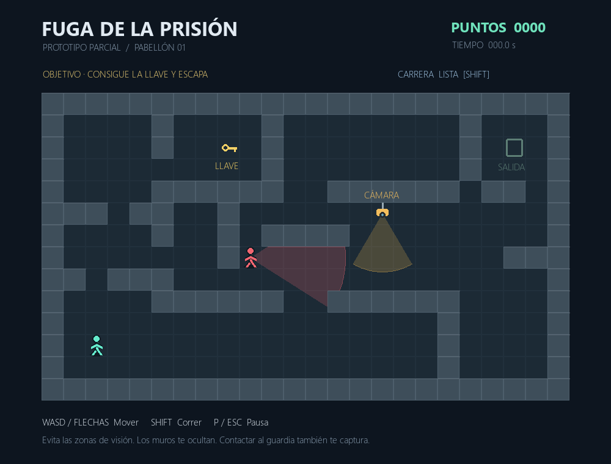
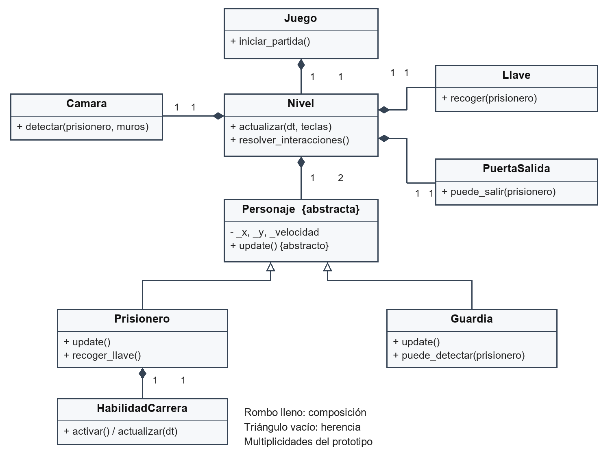
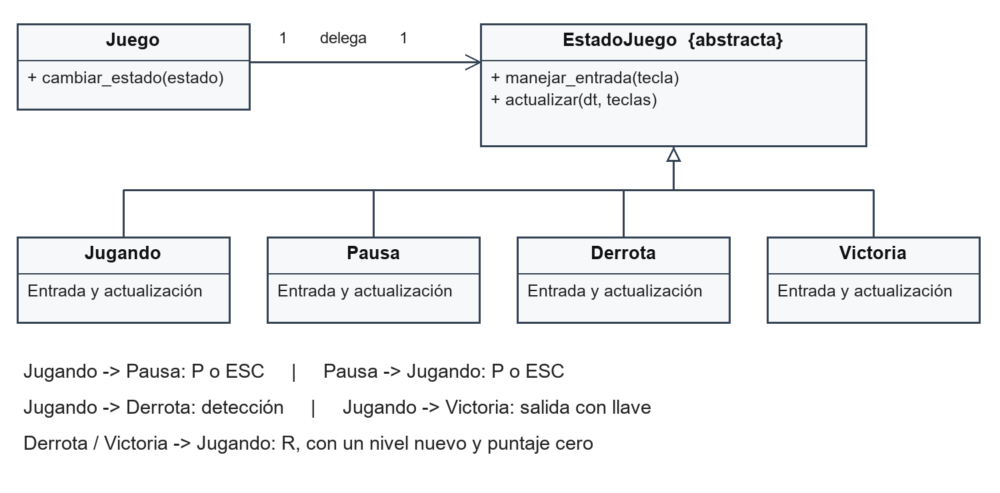
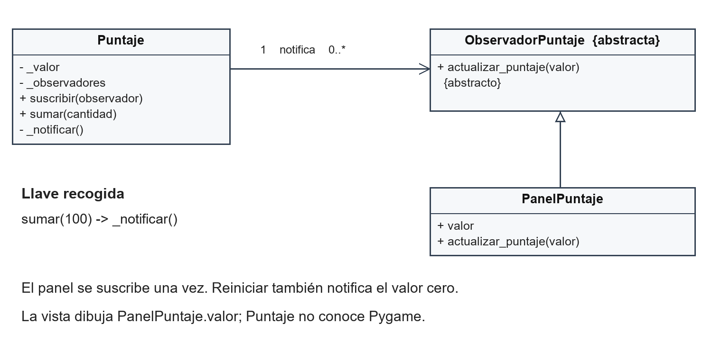
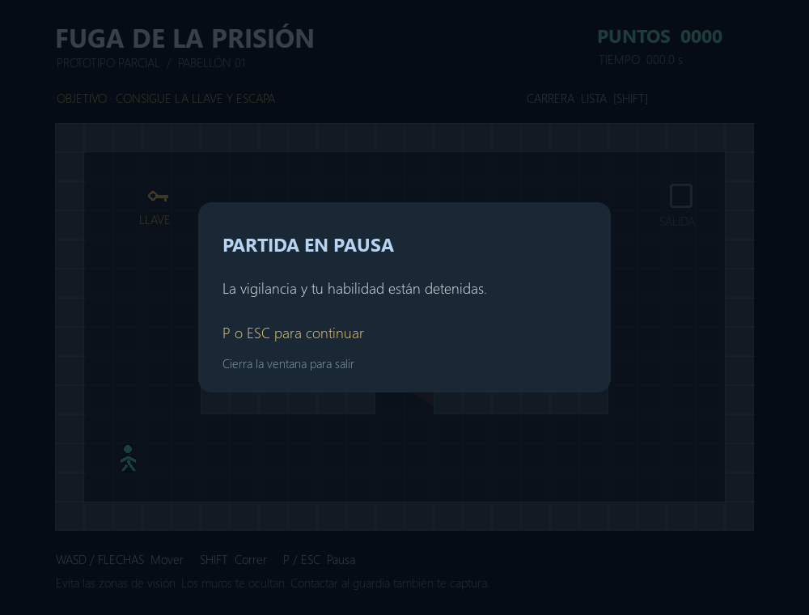
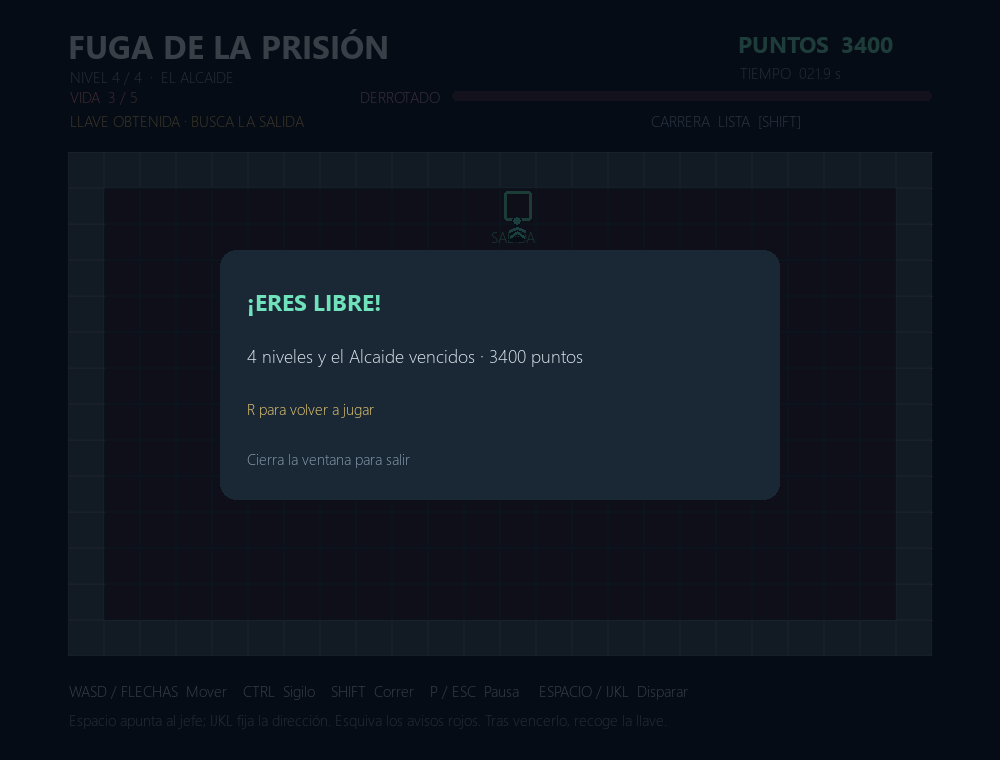

# Fuga de la Prisión

### Integrantes

JOSE FERNANDO CHAVEZ LOZANO

MICKELE CARLOS TORRES VELAZCO

RICHARD AARON SORIANO CORDOVA

PIERO CEMEI ROMERO MEZA

### Resumen del avance

El avance presenta un prototipo jugable de escape con un nivel, movimiento con colisiones, patrulla de un guardia, una cámara de vigilancia, recolección de una llave, salida bloqueada, puntuación y una habilidad de carrera. El jugador pierde al ser detectado y completa el pabellón al alcanzar la salida con la llave.

La implementación utiliza una jerarquía de personajes actualizada polimórficamente, relaciones de composición y dependencia, y los patrones State y Observer. Se ejecutaron 20 pruebas automatizadas satisfactorias y una ruta completa hasta la victoria. Este informe relaciona los requisitos del curso con el código, documenta la validación y delimita las ampliaciones para el proyecto final.

Versión parcial 0.1. Corte de implementación y pruebas: 8 de octubre de 2026. La fecha de entrega es posterior al corte y permite reservar tiempo para revisión y ensayo del equipo.

## 1 Objetivos y alcance

### Objetivo general

Diseñar e implementar un videojuego 2D de escape de una prisión en Python que demuestre los principios de POO y al menos dos patrones de diseño indicados en la consigna del curso.

### Objetivos específicos

Modelar personajes y objetos mediante UML; implementar movimiento, vigilancia, recolección y escape; aplicar herencia, polimorfismo, encapsulamiento, abstracción, composición y dependencia; separar el flujo de la partida y la actualización del puntaje; registrar avances en Git y comprobar las reglas con pruebas reproducibles.

### Alcance del parcial

Se implementó el pabellón inicial con un prisionero, un guardia, una cámara, una llave y una salida. Incluye pausa, derrota, victoria, reinicio y carrera temporal. Los gráficos son figuras generadas por el código; no se emplearon imágenes o sonidos de terceros.

| Requisito del curso [1] | Estado en el parcial |
| --- | --- |
| Videojuego 2D y puntuación, p. 1 | Implementados con Pygame y marcador observable. |
| Distintos niveles, p. 1 | Un nivel implementado; ampliación multinivel pendiente para el final. |
| Protagonista y personajes secundarios, p. 1 | Prisionero y un guardia; más secundarios en niveles posteriores. |
| Tema 13 y seguridad, p. 2 | Guardia, cámara y salida que exige llave. |
| UML y jerarquía con update(), p. 2 | Diagramas de este informe y llamada común en Nivel. |
| Encapsulamiento, abstracción y relaciones, p. 2 | Validados en clases y pruebas. |
| Git durante el desarrollo, p. 2 | Historial local desde la planificación. |
| Al menos dos patrones, pp. 2 y 3 | State y Observer implementados. |
| API externa, p. 3 | No implementada. Obligatoriedad por confirmar: el título indica sugerencia y el cuerpo emplea debe. |

La consigna describe el proyecto final y no establece una lista específica de entregables del parcial. El alcance presentado permite demostrar el diseño y un ciclo completo de juego; no implica que se hayan completado los requisitos del producto final.

## 2 Diseño del juego

El jugador recorre un mapa con vista superior. Debe observar los campos de visión, recoger la llave y llegar a la salida. Los muros actúan como obstáculos físicos y visuales. El mapa inicial permite una ruta segura y también rutas expuestas para demostrar detección y derrota.



| Regla | Comportamiento implementado |
| --- | --- |
| Movimiento | WASD o flechas; misma velocidad total en diagonal; colisión circular contra muros. |
| Detección | Cono con alcance y bloqueo por muros; contacto con guardia también captura. Se evalúa el centro del jugador. |
| Llave y salida | Una llave aporta 100 puntos. Salir con ella aporta 500, una sola vez. |
| Prioridad | La captura prevalece sobre recoger la llave o alcanzar la salida en la misma actualización. |
| Carrera | Shift: velocidad por 1,5 durante 2 s; recarga de 5 s después del efecto. |
| Pausa y reinicio | P o Escape congelan la simulación; R tras victoria o derrota crea un nivel nuevo y pone el puntaje en cero. |

## 3 Requisitos funcionales y casos de uso

| ID | Función | Criterio de aceptación |
| --- | --- | --- |
| RF01 | Iniciar | Mapa con todos los elementos y puntaje cero. |
| RF02 | Mover | Controles responden y el personaje no atraviesa muros. |
| RF03 | Patrullar | Guardia recorre dos puntos y orienta su campo visual. |
| RF04 | Detectar | Guardia o cámara provocan derrota; los muros bloquean la visión. |
| RF05 | Recoger | Llave se retira y suma 100 puntos exactamente una vez. |
| RF06 | Escapar | Salida exige llave y termina el nivel con 600 puntos totales. |
| RF07 | Notificar puntaje | El panel recibe los cambios mediante Observer. |
| RF08 | Pausar | No avanzan posiciones, tiempo ni habilidad durante la pausa. |
| RF09 | Reiniciar | Se restauran posiciones, llave, habilidad y puntaje. |
| RF10 | Correr | Duración y recarga limitan la activación; se conservan colisiones. |

### CU01 Completar el pabellón

Actor: jugador. Precondición: partida en estado Jugando. Flujo: el jugador avanza evitando vigilancia, recoge la llave, observa el aumento de 100 puntos y alcanza la salida. El nivel concede 500 puntos adicionales y Juego cambia a Victoria. Postcondición: simulación detenida, 600 puntos y opción de reinicio.

Alternativas: si alcanza la salida sin llave, la partida continúa; si entra al campo de visión o contacta al guardia, cambia a Derrota; si pulsa P o Escape, pasa a Pausa y conserva su progreso.

### CU02 Reiniciar tras un resultado

Actor: jugador. Precondición: Victoria o Derrota. Al pulsar R, Juego reinicia el objeto Puntaje, crea un nuevo Nivel y activa Jugando. Se restaura la llave, la posición inicial y la disponibilidad de la habilidad. Reiniciar durante la partida no es un control habilitado.

### Condiciones de calidad

La lógica se puede probar sin abrir una ventana. La interfaz comunica objetivo, controles, puntaje, tiempo y disponibilidad de carrera. El bucle solicita 60 actualizaciones por segundo y limita a 0,05 s el paso de simulación ante demoras; esto no constituye una medición de rendimiento en otros equipos.

## 4 Modelo de clases del prototipo



Juego coordina el estado, el nivel y la puntuación. Nivel construye sus personajes y objetos; por ello, su relación con esos elementos es de composición. Contiene exactamente dos personajes: un Prisionero y un Guardia. Al reiniciar se crea otra instancia de Nivel.

Personaje declara update() como operación abstracta. Prisionero interpreta los controles y actualiza su carrera; Guardia sigue su ruta y orienta su visión. Ambos reciben una referencia al nivel, donde encuentran el tiempo de actualización y el contexto necesario.

```
for personaje in self.personajes:
    personaje.update()
```

El fragmento pertenece a Nivel.actualizar(). La llamada es idéntica para ambos objetos y el comportamiento depende de su clase concreta. No hay una selección por tipo para decidir cuál update ejecutar.

PuertaSalida.puede_salir(prisionero) depende temporalmente del objeto recibido y no lo conserva como atributo. La cámara se modela como dispositivo, no como subclase de Personaje. Llave se responsabiliza de su disponibilidad y recolección.

## 5 Aplicación del patrón State

Juego conserva el estado activo y delega manejar_entrada() y actualizar(). Cada estado implementa ambas operaciones. Esta organización permite que pausa, derrota y victoria detengan la simulación sin incorporar esas decisiones en todos los objetos del mapa.



| Estado | Entrada y actualización |
| --- | --- |
| Jugando | Actualiza Nivel; P o Escape activan Pausa y Shift solicita carrera. El resultado del nivel activa Victoria o Derrota. |
| Pausa | P o Escape reanudan. actualizar() no modifica la simulación. |
| Derrota | R inicia una nueva partida. La simulación permanece detenida. |
| Victoria | R inicia una nueva partida. La simulación permanece detenida. |

```
def actualizar(self, dt, teclas):
    resultado = self.juego.nivel.actualizar(dt, teclas)
    if resultado == "derrota":
        self.juego.cambiar_estado(Derrota(self.juego))
    elif resultado == "victoria":
        self.juego.cambiar_estado(Victoria(self.juego))
```

Fragmento de Jugando en src/estados.py. Las pruebas comprueban que pausar conserva posiciones, tiempo y habilidad, y que reanudar restituye el movimiento. Perder el foco de la ventana también solicita pausa para evitar una captura mientras el jugador usa otra aplicación.

## 6 Observer y protección de los datos



Puntaje es el sujeto observado. Mantiene su valor y una lista de objetos suscritos. Al sumar o reiniciar, invoca actualizar_puntaje(valor) en cada observador. PanelPuntaje recibe el valor y Vista lo dibuja; el cálculo del puntaje no importa Pygame ni decide cómo se representa el texto.

La suscripción del panel ocurre una sola vez al construir Juego. El mismo panel permanece entre reinicios. suscribir() evita duplicados y desuscribir() permite retirar un observador. Se comprueban el orden de notificaciones, la ausencia de duplicados y la desuscripción.

### Encapsulamiento y abstracción

Puntaje expone sumar() y reiniciar() y rechaza incrementos negativos, cero, booleanos, texto o números no enteros. Personaje controla sus coordenadas mediante mover(), que comprueba colisiones en pasos pequeños. El prefijo _ expresa uso interno en Python; la protección funcional se obtiene aplicando estos métodos de validación.

Personaje, EstadoJuego y ObservadorPuntaje son clases abstractas definidas con ABC y abstractmethod [3]. Cada una expresa un contrato distinto: comportamiento de personajes, flujo de partida y recepción de cambios de puntuación.

### Composición y dependencia

El prisionero crea y posee HabilidadCarrera. Esta clase gestiona duración y recarga; el prisionero utiliza su multiplicador de velocidad. La composición permite probar esos temporizadores por separado. Por su parte, Camara.detectar(prisionero, muros) y PuertaSalida.puede_salir(prisionero) consultan parámetros sin asumir su propiedad.

La vista centraliza el dibujo y no participa en las decisiones de victoria o derrota. Esta separación facilita comprobar las reglas sin una ventana y cambiar la representación visual sin modificar el conteo de puntos.

## 7 Implementación y trazabilidad

| Archivo | Responsabilidad principal |
| --- | --- |
| main.py | Ventana, reloj, teclado, eventos y bucle principal. |
| src/juego.py | Coordinación, reinicio y delegación al estado. |
| src/nivel.py | Mapa, cámara, llave, salida y orden de interacciones. |
| src/personajes.py | Jerarquía, movimiento, patrulla y habilidad. |
| src/estados.py | State con cuatro estados concretos. |
| src/puntuacion.py | Observer, validación del puntaje y panel. |
| src/geometria.py | Colisiones, segmentos y visibilidad. |
| src/vista.py | Mapa, campos visuales, personajes e interfaz. |
| tests/test_juego.py | 20 casos automatizados de reglas e integración. |
| tools/verificar.py | Ejecución de pruebas, eventos y capturas. |

### Secuencia de actualización

En cada fotograma se procesan eventos, se leen controles y Juego delega al estado activo. Jugando actualiza Nivel; este llama update() en cada personaje y resuelve primero la detección, después la llave y finalmente la salida. Las transiciones detienen nuevas actualizaciones del nivel terminado. Vista dibuja el resultado y muestra el valor recibido por PanelPuntaje.

### Decisiones técnicas

Se utilizó Pygame 2.6.1 [2] y se fijó esa versión en requirements.txt. Las verificaciones se realizaron con Python 3.12.14. El juego no requiere conexión a Internet durante la partida. Las coordenadas del modelo se expresan respecto al mapa; la vista añade el desplazamiento de pantalla únicamente al dibujar.

Los campos de visión dibujados se recortan contra los mismos muros que intervienen en la detección. Se usa una aproximación de 61 rayos para mostrar cada cono; la detección utiliza un segmento directo entre el vigilante y el centro del jugador.

### Historial de Git

La planificación se registró en cfaba6e. El prototipo y sus primeras evidencias se registraron en 8917f20. Los commits siguientes corresponden a la documentación y al empaquetado del parcial. El repositorio es local; no se ha publicado en un alojamiento remoto.

## 8 Pruebas y resultados

El 8 de octubre se ejecutaron 20 pruebas con unittest: 0 fallos y 0 errores. Los resultados completos se encuentran en docs/evidencias/pruebas.txt y resultados.json. La tabla resume los escenarios realmente comprobados.

| Caso | Escenario | Resultado |
| --- | --- | --- |
| T01 | Personaje abstracto no instanciable | Conforme |
| T02 | Colisión con los cuatro bordes | Conforme |
| T03 | Muro interior sin atravesarlo | Conforme |
| T04 | Velocidad diagonal normalizada | Conforme |
| T05 | Alcance, cono y muro en la visión | Conforme |
| T06 | Captura por cámara | Conforme |
| T07 | Patrulla y captura por guardia | Conforme |
| T08 | Captura por contacto desde atrás | Conforme |
| T09 | Puntos de llave sin duplicación | Conforme |
| T10 | Salida exige llave y premio único | Conforme |
| T11 | Derrota prevalece sobre victoria | Conforme |
| T12 | Pausa congela y permite reanudar | Conforme |
| T13 | Reinicio restaura el estado inicial | Conforme |
| T14 | Observer sin duplicados y con retiro | Conforme |
| T15 | Puntaje rechaza entradas inválidas | Conforme |
| T16 | Llamadas update polimórficas | Conforme |
| T17 | Duración y recarga de carrera | Conforme |
| T18 | Carrera acelera y respeta colisiones | Conforme |
| T19 | Tiempo inválido y demora de ventana | Conforme |
| T20 | Ruta completa mediante movimiento | Conforme |

La ruta completa utilizó 872 actualizaciones a 1/120 s, equivalentes a 7.267 s de simulación, y finalizó con 600 puntos. Es un recorrido automatizado, no una medición del desempeño de una persona.

La integración comprobó P, Escape, pérdida de foco, R y cierre. Las capturas provienen del renderizador Pygame con SDL en modo sin ventana. Falta el ensayo humano con teclado en el equipo de exposición; las pruebas automatizadas no sustituyen esa revisión de interacción y rendimiento.

## 9 Evidencia de los estados





La captura de derrota se conserva en docs/evidencias/04_derrota.png. Se preparó un contacto con el guardia para comprobar ese resultado y su representación visual.

## 10 Manual de instalación y demostración

### Preparación del equipo

Se recomienda utilizar Python 3.12 para reproducir el entorno validado. Extraer el paquete, abrir una terminal dentro de la carpeta Proyecto_Fuga_Prision y ejecutar los siguientes comandos. La primera instalación de Pygame necesita acceso a Internet.

```
python -m venv .venv
.venv\Scripts\python.exe -m pip install -r requirements.txt
.venv\Scripts\python.exe main.py
```

En Windows, si el comando python no corresponde a Python 3.12, usar py -3.12 para crear el entorno. Si aparece No module named pygame, comprobar que la instalación y la ejecución utilizan el mismo intérprete del entorno virtual.

### Controles

| Acción | Tecla |
| --- | --- |
| Mover | WASD o flechas |
| Activar carrera | Shift; requiere estar disponible |
| Pausar o reanudar | P o Escape |
| Reiniciar tras victoria o derrota | R |
| Salir | Cerrar la ventana |

### Verificación reproducible

```
.venv\Scripts\python.exe -m unittest discover -s tests -v
.venv\Scripts\python.exe tools\verificar.py
```

El primer comando ejecuta las reglas. El segundo también regenera cuatro capturas y el resumen JSON; usa SDL sin ventana. La carpeta .venv no forma parte del paquete y se debe crear en cada equipo.

### Secuencia de demostración

1. Mostrar el objetivo y los elementos del mapa. 2. Moverse contra un muro. 3. Activar Shift y observar su recarga. 4. Pausar y comprobar que el guardia y el temporizador se detienen. 5. Entrar en vigilancia para mostrar derrota y reiniciar con R. 6. Recoger la llave, mostrar 100 puntos y alcanzar la salida para obtener 600.

Para ensayar una victoria sencilla: subir por el pasillo izquierdo, recoger la llave, continuar hasta la fila superior transitable, desplazarse hacia la derecha por encima de la cámara y bajar a la salida. El mapa inicial prioriza la demostración de las reglas; su dificultad se ajustará después del ensayo.

## 11 Trabajo pendiente y conclusiones

### Ampliaciones para el proyecto final

El siguiente incremento debe añadir al menos un segundo nivel para atender el requisito de distintos niveles. Se mantienen como propuesta tres escenarios: pabellón, vigilancia y salida exterior. Cada nivel deberá variar obstáculos o vigilancia y conservar el puntaje acumulado al avanzar.

La API externa sigue pendiente de aclaración con el docente. Si se exige, se incorporará una clase APIClient que concentre la comunicación y maneje fallos de red sin impedir una partida local. No se atribuye al prototipo una integración que todavía no existe.

| Fecha | Actividad prevista hasta el parcial |
| --- | --- |
| 8 de octubre | Implementación y comprobación automatizada del prototipo; documentación del avance. |
| 9 al 10 de octubre | Revisar consigna del parcial con el docente y ensayar el juego con teclado. |
| 11 al 12 de octubre | Corregir problemas observados y ajustar dificultad; mantener pruebas. |
| 13 al 14 de octubre | Revisar correspondencia UML y código y practicar la explicación de POO. |
| 15 de octubre | Probar instalación en el equipo de presentación y ensayar la demostración. |
| 16 de octubre | Entregar el parcial y presentar el avance alcanzado. |

### Conclusiones del avance

El prototipo implementa un ciclo completo de juego y demuestra los dos patrones seleccionados. State determina qué entradas y actualizaciones admite cada momento de la partida. Observer comunica los cambios del puntaje sin introducir operaciones gráficas en la clase que los calcula.

Las pruebas ejecutadas respaldan colisiones, detección, prioridades, temporizadores, reinicio y una ruta de victoria. El alcance validado corresponde a un nivel y a ejecución automatizada. Las próximas revisiones deben centrarse en la experiencia de uso y en ampliar el contenido del juego sin alterar los contratos que ya se pueden comprobar.

### Referencias

[1] Programación Orientada a Objetos. Proyecto Final POO. Consigna del curso, ciclo 2026-2, 3 páginas. Archivo proporcionado por el estudiante.

[2] Pygame. Documentación oficial. https://www.pygame.org/docs/ . Consultada el 8 de octubre de 2026.

[3] Python Software Foundation. abc — Abstract Base Classes. https://docs.python.org/3/library/abc.html . Consultada el 8 de octubre de 2026.
