# Las 25 clases: función, POO, UML y código

Este material amplía los apartados III, IV y VIII del informe. Cada recorte proviene de `docs/diagramas/modelo_parcial.png`; no es un UML redibujado. Los fragmentos se han formateado para lectura sin alterar su lógica y no sustituyen los archivos completos del juego.

Las clases no aplican todas las técnicas por igual. Herencia, encapsulamiento y relaciones entre objetos se justifican con lo que existe en el código. Dataclass es una herramienta de Python; State y Observer son patrones.

## 1. Juego

**Función:** Coordina la campaña, los niveles, los puntos y el estado de la partida.

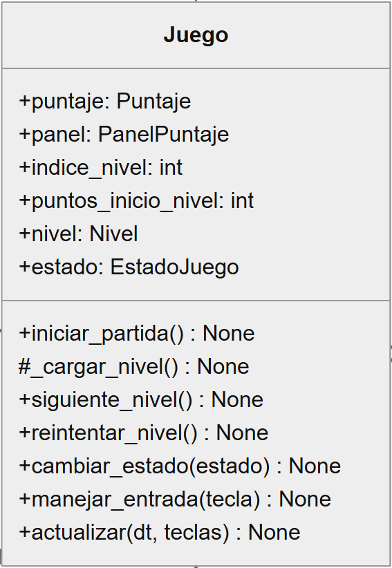

**POO que aplica:**

- Composición: crea Puntaje, PanelPuntaje y Nivel.
- Polimorfismo: delega en el EstadoJuego activo.

Juego coordina objetos con responsabilidades distintas. La creación de las partes muestra composición. Al llamar al estado activo usa una interfaz común: el comportamiento depende de si ese objeto es Jugando, Pausa u otro estado. La suscripción del panel conecta además el patrón Observer.

**Fuente:** [src/juego.py](../src/juego.py#L7)

```python
class Juego:

    def __init__(self):
        self.puntaje = Puntaje()
        self.panel = PanelPuntaje()
        self.puntaje.suscribir(self.panel)

    def manejar_entrada(self, tecla):
        self.estado.manejar_entrada(tecla)
```

## 2. EstadoJuego

**Función:** Define las operaciones comunes de los estados de la partida.

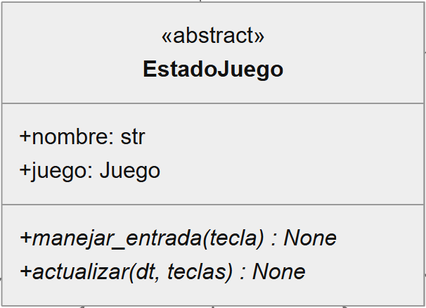

**POO que aplica:**

- Abstracción: exige implementar entrada y actualización.
- Asociación: conserva el Juego que recibe.

Hereda de ABC y define el contrato de los estados. Los decoradores abstractmethod impiden instanciar una implementación incompleta. Guarda una referencia a Juego sin construirlo. Es la base del patrón State, no un estado concreto que el usuario vea en pantalla.

**Fuente:** [src/estados.py](../src/estados.py#L4)

```python
class EstadoJuego(ABC):

    def __init__(self, juego):
        self.juego = juego

    @abstractmethod
    def actualizar(self, dt, teclas):
        pass
```

## 3. Jugando

**Función:** Mantiene activa la simulación del nivel.

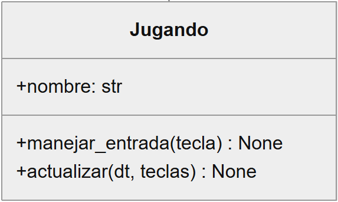

**POO que aplica:**

- Herencia: deriva de EstadoJuego.
- Polimorfismo: actualizar ejecuta la simulación.

Implementa las operaciones heredadas para una partida activa. Juego puede llamarla por la misma interfaz que usa con Pausa. El resultado del nivel decide la transición a derrota, victoria o nivel completado. Es uno de los estados concretos de State.

**Fuente:** [src/estados.py](../src/estados.py#L19)

```python
class Jugando(EstadoJuego):

    def actualizar(self, dt, teclas):
        resultado = self.juego.nivel.actualizar(dt, teclas)
        if resultado == "derrota":
            self.juego.cambiar_estado(Derrota(self.juego))
        elif resultado == "victoria":
            self.juego.cambiar_estado(Victoria(self.juego))
        elif resultado == "nivel_completado":
            self.juego.cambiar_estado(NivelCompletado(self.juego))
```

## 4. Pausa

**Función:** Detiene la simulación hasta que el jugador continúa.

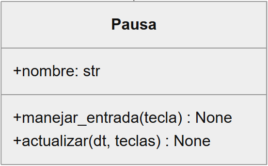

**POO que aplica:**

- Herencia: deriva de EstadoJuego.
- Polimorfismo: actualizar deja el nivel detenido.

Comparte la interfaz de Jugando, pero su actualización no realiza ninguna operación. Esa diferencia de comportamiento con la misma llamada demuestra polimorfismo. Su método de entrada vuelve a Jugando cuando recibe la acción de pausa.

**Fuente:** [src/estados.py](../src/estados.py#L38)

```python
class Pausa(EstadoJuego):

    def manejar_entrada(self, tecla):
        if tecla == "pausa":
            self.juego.cambiar_estado(Jugando(self.juego))

    def actualizar(self, dt, teclas):
        pass
```

## 5. Derrota

**Función:** Espera la decisión del jugador después de perder.

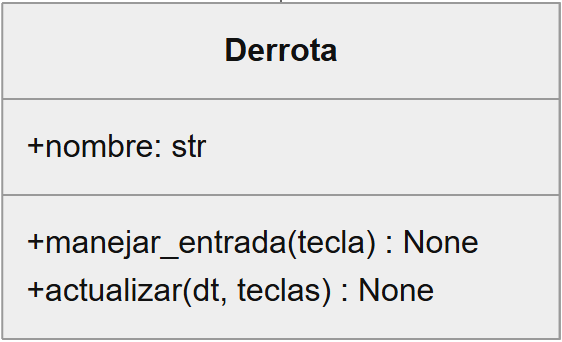

**POO que aplica:**

- Herencia: deriva de EstadoJuego.
- Polimorfismo: la entrada permite reintentar o reiniciar.

El mismo mensaje manejar_entrada tiene aquí el comportamiento propio de perder. Reintentar restaura el nivel actual, mientras nueva_partida inicia la campaña desde cero. actualizar no hace avanzar la simulación. Participa en State.

**Fuente:** [src/estados.py](../src/estados.py#L49)

```python
class Derrota(EstadoJuego):

    def manejar_entrada(self, tecla):
        if tecla == "reiniciar":
            self.juego.reintentar_nivel()
        elif tecla == "nueva_partida":
            self.juego.iniciar_partida()

    def actualizar(self, dt, teclas):
        pass
```

## 6. Victoria

**Función:** Representa el final de la campaña completada.

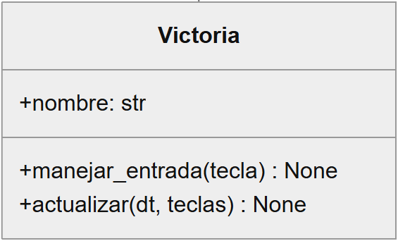

**POO que aplica:**

- Herencia: deriva de EstadoJuego.
- Polimorfismo: reiniciar inicia una campaña nueva.

Representa una campaña terminada. Su implementación de entrada interpreta reiniciar como comenzar otra campaña. Su actualización vacía mantiene detenido el nivel final. Las otras clases concretas responden a la misma interfaz con decisiones distintas.

**Fuente:** [src/estados.py](../src/estados.py#L62)

```python
class Victoria(EstadoJuego):

    def manejar_entrada(self, tecla):
        if tecla == "reiniciar":
            self.juego.iniciar_partida()

    def actualizar(self, dt, teclas):
        pass
```

## 7. NivelCompletado

**Función:** Separa el final de un nivel del final de toda la campaña.

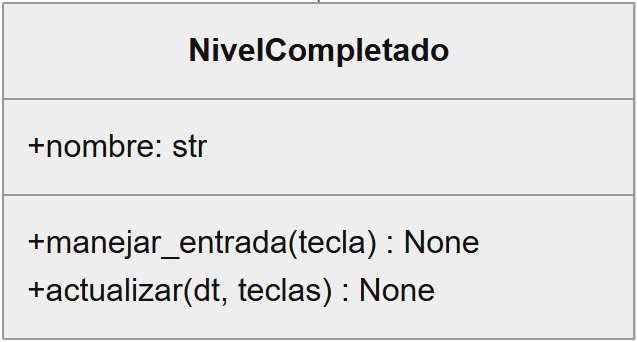

**POO que aplica:**

- Herencia: deriva de EstadoJuego.
- Polimorfismo: continuar carga el siguiente nivel.

Separa la salida de un nivel de la victoria de toda la campaña. La implementación de manejar_entrada decide cuándo avanzar y cuándo empezar desde cero. No actualiza el nivel mientras espera esa decisión. Es el quinto estado concreto de State.

**Fuente:** [src/estados.py](../src/estados.py#L73)

```python
class NivelCompletado(EstadoJuego):

    def manejar_entrada(self, tecla):
        if tecla == "continuar":
            self.juego.siguiente_nivel()
        elif tecla == "nueva_partida":
            self.juego.iniciar_partida()

    def actualizar(self, dt, teclas):
        pass
```

## 8. Nivel

**Función:** Coordina uno de los cuatro niveles y resuelve sus interacciones.

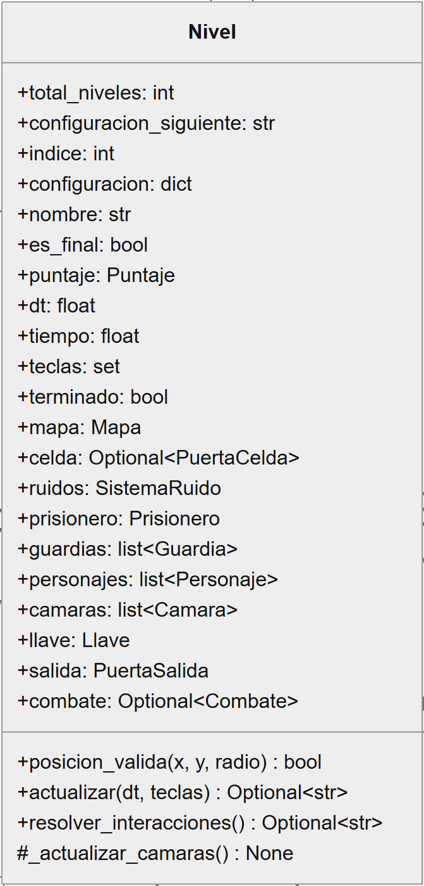

**POO que aplica:**

- Composición: construye Mapa y personajes.
- Agregación: recibe el Puntaje compartido.
- Polimorfismo: llama update sin distinguir personajes.

Recibe el Puntaje que Juego conserva entre niveles, pero construye las partes propias de la etapa. En self.personajes conviven Prisionero y Guardia. El recorrido del fragmento no pregunta su tipo: cada instancia ejecuta su versión de update. La composición es una relación del diseño, no una orden de destrucción automática de Python.

**Fuente:** [src/nivel.py](../src/nivel.py#L85)

```python
class Nivel:

    def __init__(self, puntaje, indice=0):
        self.puntaje = puntaje
        self.mapa = Mapa(PLANOS[indice])

    def actualizar(self, dt, teclas):
        for personaje in self.personajes:
            personaje.update()
```

## 9. PuertaCelda

**Función:** Mantiene cerrada la celda inicial y controla cómo se fuerza su puerta.

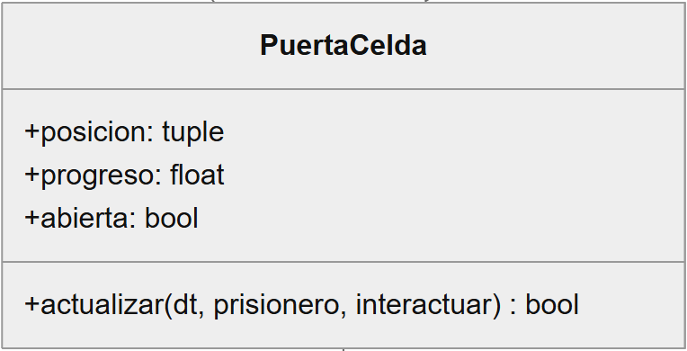

**POO que aplica:**

- Composición: Nivel crea su puerta inicial.
- Dependencia: actualizar recibe al Prisionero.

Es una parte de Nivel que controla el progreso de apertura. actualizar consulta la cercanía del Prisionero y la acción de interactuar. Cuando alcanza dos segundos cambia abierta y Nivel retira los barrotes de su mapa. Sus atributos son públicos: no es un ejemplo de acceso restringido mediante getters y setters.

**Fuente:** [src/nivel.py](../src/nivel.py#L32)

```python
class PuertaCelda:

    def actualizar(self, dt, prisionero, interactuar):
        if (
            not interactuar
            or distancia(self.posicion, prisionero.get_posicion())
            > 48
        ):
            self.progreso = 0.0
            return False
```

## 10. Mapa

**Función:** Conserva el plano y reúne las reglas de paredes y caminos.

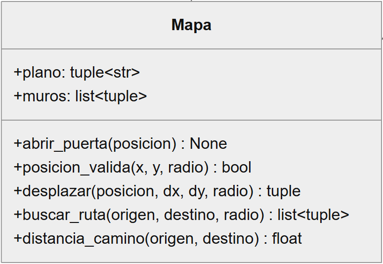

**POO que aplica:**

- Composición: Nivel crea su propio Mapa.
- Abstracción: ofrece colisiones y rutas mediante métodos.

Los consumidores piden una ruta o una posición válida sin implementar la búsqueda de caminos. Aquí abstracción significa ocultar el detalle del algoritmo tras una operación útil; Mapa no es una clase abstracta ABC. Nivel, personajes y ruido consultan la misma instancia para usar paredes coherentes.

**Fuente:** [src/mapa.py](../src/mapa.py#L82)

```python
class Mapa:

    def distancia_camino(self, origen, destino):
        ruta = self.buscar_ruta(origen, destino)
        if not ruta:
            return math.inf
        return sum(
            distancia(a, b) for a, b in zip([origen, *ruta], ruta)
        )
```

## 11. Personaje

**Función:** Reúne posición, tamaño y movimiento de los personajes.

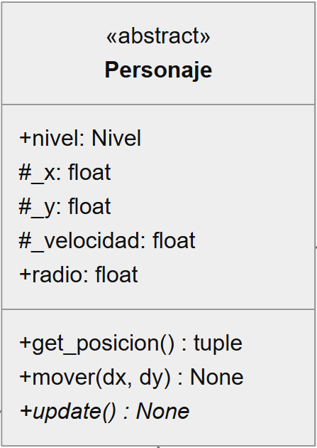

**POO que aplica:**

- Abstracción y herencia: base de Prisionero y Guardia.
- Encapsulamiento: _x, _y y _velocidad son internos.
- Asociación: guarda el Nivel que recibe.

La clase abstracta reúne posición y movimiento común. get_posicion devuelve las coordenadas, mientras mover aplica las colisiones del mapa. update queda como contrato obligatorio para las clases hijas. El guion bajo señala uso interno por convención, no una prohibición de acceso del lenguaje.

**Fuente:** [src/personajes.py](../src/personajes.py#L39)

```python
class Personaje(ABC):

    def __init__(self, nivel, x, y, velocidad):
        self.nivel = nivel
        self._x = float(x)
        self._y = float(y)

    def get_posicion(self):
        return self._x, self._y

    @abstractmethod
    def update(self):
        pass
```

## 12. Prisionero

**Función:** Es el personaje controlado por el jugador y el origen del ruido de pasos.

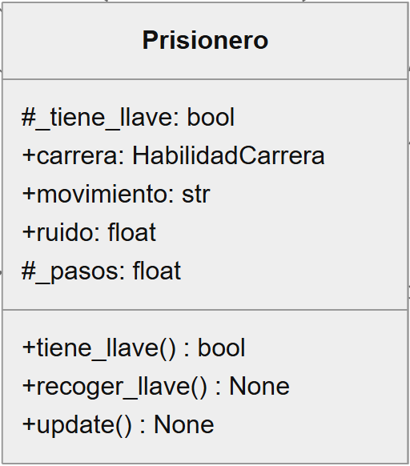

**POO que aplica:**

- Herencia y polimorfismo: implementa update de Personaje.
- Composición: crea su HabilidadCarrera.
- Encapsulamiento: controla _tiene_llave con métodos.

Reutiliza el movimiento de Personaje y define cómo responde al teclado. Su habilidad de carrera es una parte creada por él. Los métodos tiene_llave y recoger_llave concentran la consulta y el cambio del estado de la llave. Su update participa en la misma llamada polimórfica que el de Guardia.

**Fuente:** [src/personajes.py](../src/personajes.py#L58)

```python
class Prisionero(Personaje):

    def __init__(self, nivel, x, y):
        super().__init__(nivel, x, y, 145)
        self.carrera = HabilidadCarrera()

    def tiene_llave(self):
        return self._tiene_llave

    def recoger_llave(self):
        self._tiene_llave = True
```

## 13. Guardia

**Función:** Patrulla, escucha ruidos, persigue al jugador y lo captura por contacto.

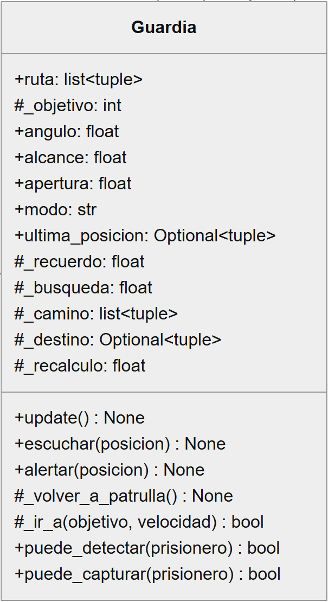

**POO que aplica:**

- Herencia y polimorfismo: implementa update de Personaje.
- Encapsulamiento: gestiona _objetivo y _camino.
- Dependencia: consulta al Prisionero para detectarlo.

Comparte la base Personaje, pero decide una ruta y una conducta de vigilancia. Los atributos con guion bajo y métodos internos organizan su objetivo y camino. escuchar recibe las notificaciones del ruido. Sus modos son cadenas dentro de la clase; no forman la jerarquía de State usada por Juego.

**Fuente:** [src/personajes.py](../src/personajes.py#L97)

```python
class Guardia(Personaje):

    def __init__(self, nivel, ruta):
        self._objetivo = 1
        self._camino = []

    def update(self):
        if self.puede_detectar(self.nivel.prisionero):
            self.alertar(self.nivel.prisionero.get_posicion())
        elif self.modo == "PERSIGUE" and self._recuerdo == 0:
            self.modo = "BUSCA"
```

## 14. HabilidadCarrera

**Función:** Controla el aumento temporal de velocidad del prisionero.

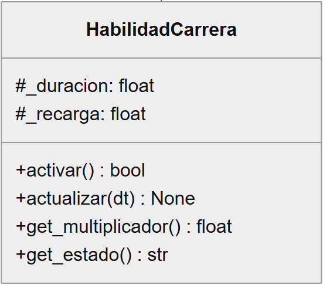

**POO que aplica:**

- Encapsulamiento: gestiona _duracion y _recarga.
- Composición: es creada por cada Prisionero.

Concentra la duración, la recarga y las reglas de activación. Otros objetos piden activar o consultar el multiplicador sin repetir esas reglas. No hereda de Personaje: es una habilidad que el Prisionero contiene. Sus campos internos se identifican mediante el guion bajo.

**Fuente:** [src/personajes.py](../src/personajes.py#L6)

```python
class HabilidadCarrera:

    def activar(self):
        if self._duracion > 0 or self._recarga > 0:
            return False
        self._duracion = 2.0
        return True

    def get_multiplicador(self):
        if self._duracion > 0:
            return 1.5
        return 1.0
```

## 15. SistemaRuido

**Función:** Emite los ruidos de pasos y avisa a los guardias que pueden escucharlos.

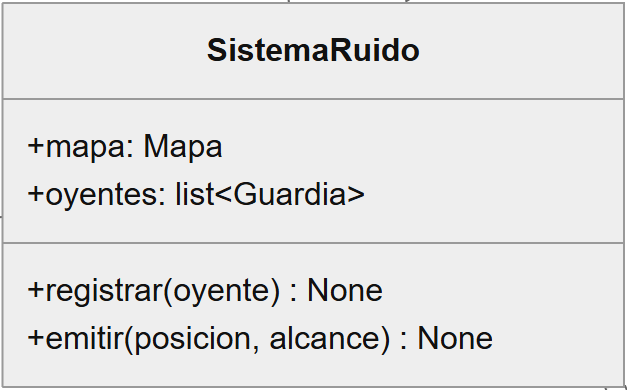

**POO que aplica:**

- Asociación: conserva el Mapa recibido.
- Agregación: registra guardias creados por Nivel.
- Notificación: avisa a los oyentes que pueden escuchar.

No construye el mapa ni los guardias: conserva referencias a objetos existentes. Usa la distancia de camino para decidir qué oyentes reciben un paso. Esta comunicación se parece a Observer, pero Guardia no hereda de ObservadorPuntaje. El ejemplo formal de ese patrón es Puntaje con PanelPuntaje.

**Fuente:** [src/ruido.py](../src/ruido.py#L4)

```python
class SistemaRuido:

    def __init__(self, mapa):
        self.mapa = mapa
        self.oyentes = []

    def registrar(self, oyente):
        if oyente not in self.oyentes:
            self.oyentes.append(oyente)
```

## 16. Camara

**Función:** Comprueba si el prisionero está dentro de su campo de visión.

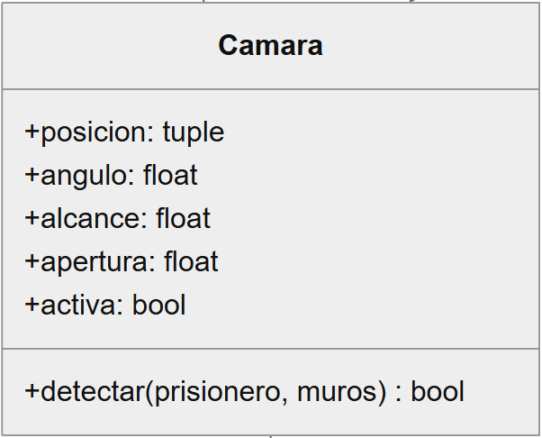

**POO que aplica:**

- Composición: Nivel construye sus cámaras.
- Dependencia: detectar recibe Prisionero y muros.

La cámara conserva su posición y campo de visión. detectar usa objetos recibidos para devolver si ve al jugador, sin guardarlo como atributo. Es dependencia de uso y no herencia de Personaje. Nivel interpreta el resultado y alerta a los guardias.

**Fuente:** [src/nivel.py](../src/nivel.py#L51)

```python
class Camara:

    def detectar(self, prisionero, muros):
        return dentro_de_vision(
            self.posicion,
            prisionero.get_posicion(),
            self.angulo,
            self.alcance,
            self.apertura,
            muros,
            prisionero.radio,
        )
```

## 17. Llave

**Función:** Es el objeto que habilita la salida.

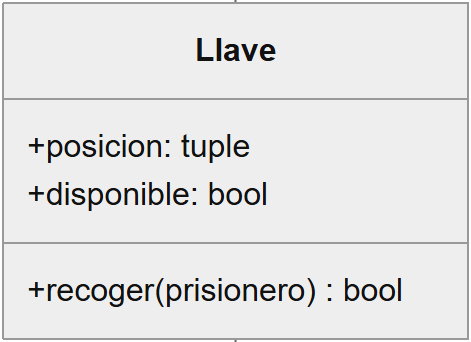

**POO que aplica:**

- Composición: cada Nivel crea su Llave.
- Dependencia: recoger utiliza el Prisionero recibido.

La llave reúne posición, disponibilidad y recogida. recoger consulta al prisionero y le comunica que obtuvo una llave, evitando concederla varias veces. El atributo disponible es público; el ejemplo de encapsulamiento controlado de la posesión está en Prisionero._tiene_llave.

**Fuente:** [src/nivel.py](../src/nivel.py#L64)

```python
class Llave:

    def recoger(self, prisionero):
        if (
            self.disponible
            and distancia(
                self.posicion, prisionero.get_posicion()
            )
            < 22
        ):
            self.disponible = False
            prisionero.recoger_llave()
            return True
        return False
```

## 18. PuertaSalida

**Función:** Representa el lugar por el que se termina un nivel.

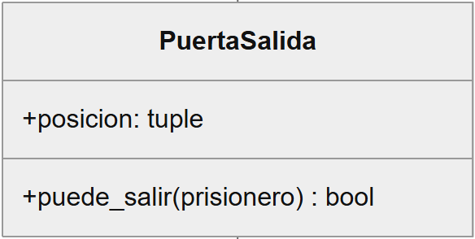

**POO que aplica:**

- Composición: Nivel crea su PuertaSalida.
- Dependencia: puede_salir consulta al Prisionero.

Agrupa la ubicación de la salida y la regla de acceso: estar cerca y tener la llave. El Prisionero se recibe como parámetro, no se crea ni se conserva en la puerta. Nivel decide después si el resultado completa una etapa o toda la campaña.

**Fuente:** [src/nivel.py](../src/nivel.py#L77)

```python
class PuertaSalida:

    def puede_salir(self, prisionero):
        return (
            prisionero.tiene_llave()
            and distancia(
                self.posicion, prisionero.get_posicion()
            )
            < 22
        )
```

## 19. Puntaje

**Función:** Conserva los puntos y avisa cuando cambian.

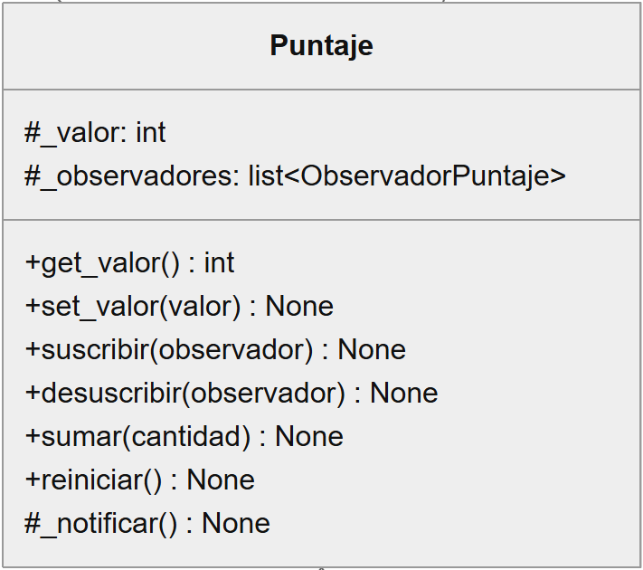

**POO que aplica:**

- Encapsulamiento: valida los cambios de _valor.
- Agregación: conserva observadores creados fuera.
- Observer: notifica mediante actualizar_puntaje.

El getter permite consultar y el setter rechaza cualquier dato que no sea un entero no negativo. El cambio llama a _notificar, que usa la interfaz de los observadores. Puntaje no conoce cómo dibuja la interfaz. El mismo objeto también participa por agregación en Nivel.

**Fuente:** [src/puntuacion.py](../src/puntuacion.py#L18)

```python
class Puntaje:

    def set_valor(self, valor):
        if type(valor) is not int or valor < 0:
            raise ValueError(
                "El puntaje debe ser un entero no negativo."
            )
        self._valor = valor
        self._notificar()

    def _notificar(self):
        for observador in tuple(self._observadores):
            observador.actualizar_puntaje(self._valor)
```

## 20. ObservadorPuntaje

**Función:** Define cómo debe recibir los cambios un observador del puntaje.

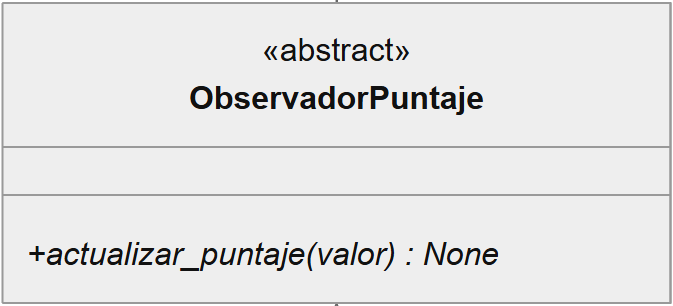

**POO que aplica:**

- Abstracción: exige implementar actualizar_puntaje.
- Herencia: es la base de PanelPuntaje.

Define el contrato para recibir un valor de puntaje. abstractmethod obliga a las clases concretas a implementar esa operación. Separa lo que el emisor puede pedir de la implementación del receptor. Es el observador abstracto del patrón Observer.

**Fuente:** [src/puntuacion.py](../src/puntuacion.py#L4)

```python
class ObservadorPuntaje(ABC):

    @abstractmethod
    def actualizar_puntaje(self, valor):
        pass
```

## 21. PanelPuntaje

**Función:** Conserva el último puntaje notificado para mostrarlo en pantalla.

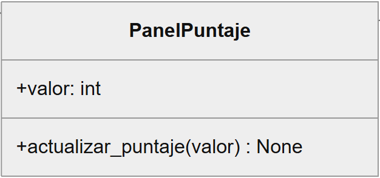

**POO que aplica:**

- Herencia: deriva de ObservadorPuntaje.
- Polimorfismo: implementa actualizar_puntaje.
- Observer: recibe el nuevo valor que luego dibuja Vista.

Puntaje puede notificarlo mediante la interfaz común de observador. La implementación concreta guarda el valor recibido. Su atributo valor es público: aquí el ejemplo principal es herencia y polimorfismo, no un campo protegido con setter. Juego lo registra mediante suscribir.

**Fuente:** [src/puntuacion.py](../src/puntuacion.py#L10)

```python
class PanelPuntaje(ObservadorPuntaje):

    def __init__(self):
        self.valor = 0

    def actualizar_puntaje(self, valor):
        self.valor = valor
```

## 22. Proyectil

**Función:** Guarda la posición, velocidad, tamaño y duración de un disparo.

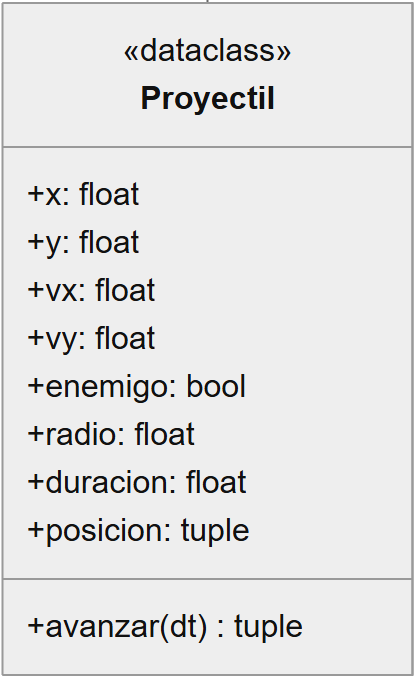

**POO que aplica:**

- Composición: Combate crea y conserva los disparos.
- Dataclass: genera el constructor de sus datos.

Agrupa posición, velocidad y duración con las operaciones del disparo. avanzar devuelve el segmento recorrido para comprobar impactos. Dataclass es una herramienta del lenguaje, no uno de los seis fundamentos de la rúbrica. Sus campos son públicos y no hereda de otra clase del juego.

**Fuente:** [src/combate.py](../src/combate.py#L8)

```python
@dataclass
class Proyectil:
    x: float
    y: float
    vx: float
    vy: float

    def avanzar(self, dt):
        inicio = self.posicion
        self.x += self.vx * dt
        self.y += self.vy * dt
        self.duracion -= dt
        return inicio, self.posicion
```

## 23. Alcaide

**Función:** Controla al jefe del último nivel.

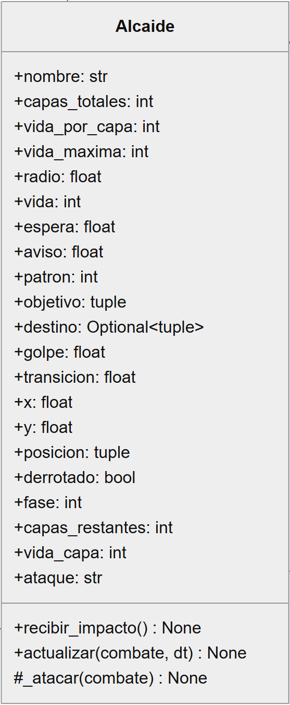

**POO que aplica:**

- Composición: Combate crea su Alcaide.
- Dependencia: actualizar recibe el Combate.
- Propiedades: consultan fase, posición y derrota.

Concentra los ataques y las reglas del jefe. Se comunica con el Combate recibido para emitir disparos o consultar el mapa. Las propiedades calculan vistas del estado, por ejemplo si ya fue derrotado. Su vida es pública, por lo que no debe presentarse como un atributo privado protegido por un setter.

**Fuente:** [src/combate.py](../src/combate.py#L47)

```python
class Alcaide:

    @property
    def posicion(self):
        return self.x, self.y

    @property
    def derrotado(self):
        return self.vida <= 0
```

## 24. Combate

**Función:** Resuelve los ataques, los proyectiles y la vida en la arena.

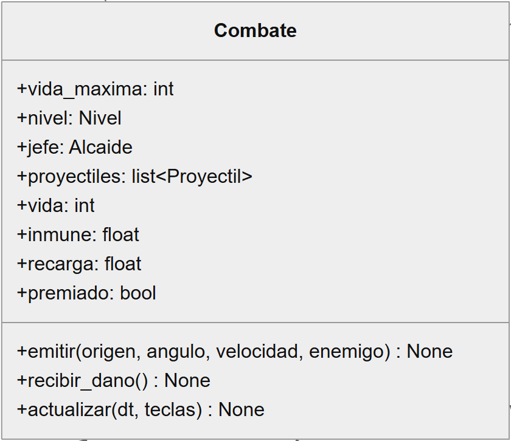

**POO que aplica:**

- Composición: crea Alcaide y Proyectil.
- Asociación: conserva el Nivel recibido.

Es una parte que Nivel crea solo para la arena. A su vez construye el jefe y mantiene los proyectiles. Guarda una referencia a Nivel para acceder al jugador y al mapa compartido. Separa las reglas del combate del dibujo que realiza Vista.

**Fuente:** [src/combate.py](../src/combate.py#L162)

```python
class Combate:
    def __init__(self, nivel):
        self.nivel = nivel
        self.jefe = Alcaide()
        self.proyectiles = []

    def emitir(self, origen, angulo, velocidad, enemigo=True):
        self.proyectiles.append(Proyectil(
            *origen, math.cos(angulo) * velocidad,
            math.sin(angulo) * velocidad, enemigo,
            6 if enemigo else 5))
```

## 25. Vista

**Función:** Dibuja la interfaz, los mapas y los personajes stickman con Pygame.

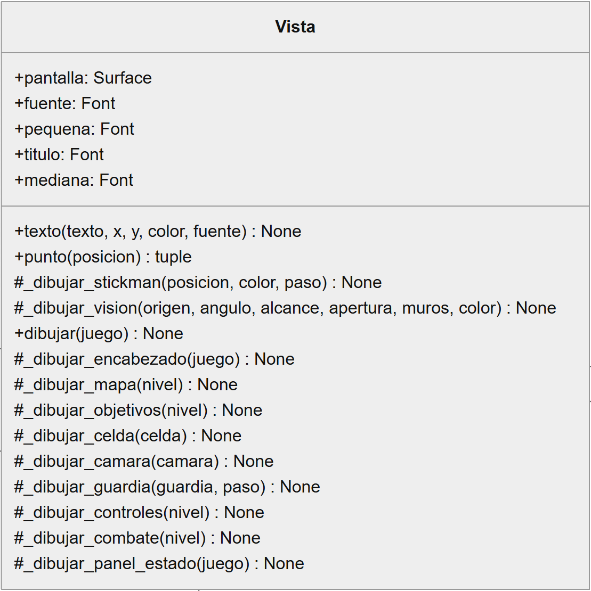

**POO que aplica:**

- Asociación: conserva la pantalla que recibe.
- Dependencia: dibujar consulta Juego y Nivel.

Recibe Juego para leer sus datos y dibujarlos con Pygame. No decide las colisiones, la captura ni el puntaje. Separar estas responsabilidades permite probar las reglas sin abrir una ventana. Su constructor recibe la pantalla; no hereda de Personaje ni de una clase propia de sprites.

**Fuente:** [src/vista.py](../src/vista.py#L12)

```python
class Vista:

    def dibujar(self, juego):
        nivel = juego.nivel
        self._dibujar_encabezado(juego)
        self._dibujar_mapa(nivel)
        self._dibujar_objetivos(nivel)
```
